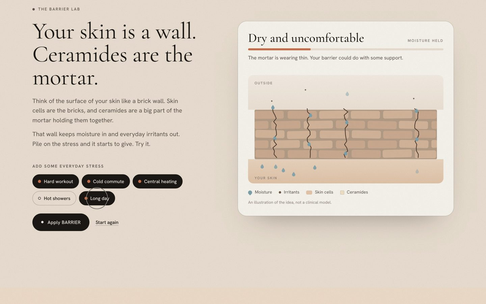

# re•set: concept site

A concept website for [re•set](https://itsreset.com) and BARRIER, their ceramide face cream. It's built to show the product off and give people a few new ways to discover it, not just read about it.


## What's in it

| Section | The idea |
| --- | --- |
| **Hero** | The dot in the re•set wordmark is a window. Scroll and it opens onto the campaign shot, landing on the dot printed on the jar, then slides aside for the intro copy. |
| **The cream** | The jar floats over a backdrop matched to the product photo, with palm-shadow light moving across it. Tap the dots on the jar for details. |
| **What's inside** | Four specimen cards, one per key ingredient, with botanical line drawings that draw themselves in. |
| **Barrier lab** | An interactive version of the "brick and mortar" explanation from the re•set journal. Add everyday stress (workouts, cold, heating) and watch the wall crack and lose moisture, then apply BARRIER to seal it. |
| **Ritual** | Drag the sun across the day. The page shifts from dawn to night and the routine changes for morning, after training and evening. |
| **Story** | Jeremiah 8:22 lights up word by word as you scroll, followed by the Balm of Gilead through history. |
| **Founder, Journal, Waitlist, FAQ** | The founder's note, the three live journal articles, the waitlist sign-up and common questions. |



All product copy, the founder's note, FAQs and journal summaries come from itsreset.com. Supporting lines were written to match that voice.

## Run it

```bash
npm install
npm run dev      # http://localhost:5173
npm run build    # production build in dist/
npm run preview  # serve the build locally
```

Stack: Vite, React 19, TypeScript, [Motion](https://motion.dev) for animation, [Lenis](https://lenis.darkroom.engineering) for smooth scrolling. Fonts are self-hosted through Fontsource (Cormorant Garamond, Playfair Display, Hanken Grotesk), so there are no third party font requests.

## Deploy

**GitHub Pages (set up):** live at **https://raman365.github.io/its-reset/** once Pages is switched on.

1. Repo **Settings → Pages → Build and deployment → Source: GitHub Actions** (one time only).
2. Every push to the default branch builds and deploys through `.github/workflows/deploy-pages.yml`. To deploy without a push, run it from the **Actions** tab.

The workflow builds with the right sub-path (`/its-reset/`) and an absolute share image, so the link shows a proper preview when you send it in WhatsApp, iMessage or Slack.

The page has `noindex` set so this concept never shows up in Google next to the real itsreset.com. Remove that line from `index.html` if it becomes the real site.

**Elsewhere:** it's a static site. On Vercel or Netlify, import the repo with build command `npm run build` and output `dist`.

## Editing

- **Copy:** everything lives in `src/content.ts`.
- **Images:** `src/assets/img`. The floating jar (`jar.webp`) is a transparent cut-out made from the product shot on itsreset.com.
- **Colours and type:** tokens at the top of `src/styles/base.css`.

## Waitlist

By default the form runs in **demo mode**: it shows the success state but sends nothing, so nobody's real list fills up with test sign-ups during review.

To send sign-ups to the existing Shopify customer list (the same one the current site uses), set an environment variable before building:

```bash
VITE_SHOPIFY_STORE=https://itsreset.com npm run build
```

The form then posts to the store's `/contact` endpoint with the `newsletter` tag, just like the live form. Shopify sometimes adds a bot check to these forms, so test a real sign-up after deploying.

## Accessibility and motion

- If someone has "reduce motion" switched on, the scroll animation is replaced by a static hero, smooth scrolling is off and looping animations stop.
- The custom dot cursor only appears on desktop mouse pointers.
- Interactive pieces (hotspots, lab controls, the sun slider, FAQ) work with a keyboard and announce changes to screen readers.

---

Brand name, product photography and copy belong to Reset Gilead Ltd. This is a design concept.
